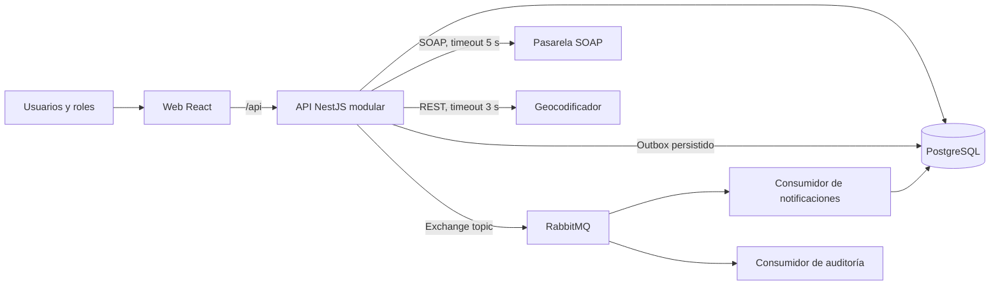
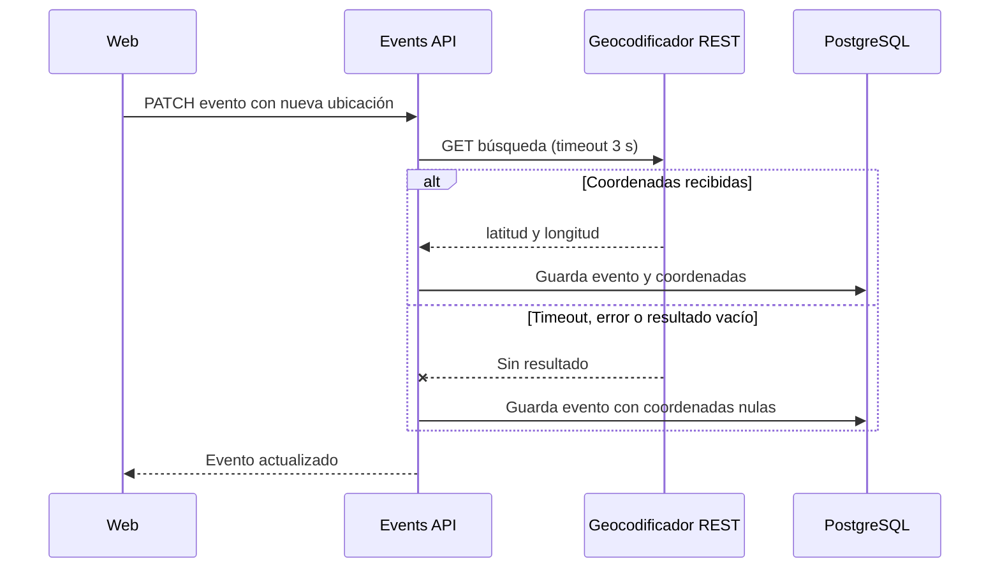
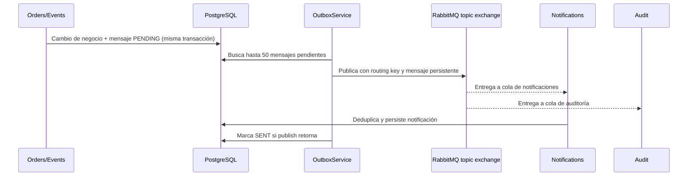

# Arquitectura de EventHub

**Estado:** arquitectura implementada (as-built)
**Revisión:** 28/11/2026

Este documento describe el sistema que existe en el repositorio. No presenta decisiones futuras o propuestas como si ya estuvieran implementadas.

## Vista general

EventHub es un monorepo pnpm con frontend React/TypeScript y API NestJS. PostgreSQL conserva usuarios, eventos, órdenes, tickets y mensajes del outbox. RabbitMQ distribuye eventos a consumidores de notificaciones y auditoría. El frontend accede a la API mediante `/api`; esa ruta es del proxy/cliente web, no un prefijo global de los controllers NestJS.



En el stack local, SOAP y geocodificación pueden apuntar a servicios mock del proyecto. Esto permite probar contratos e integración sin afirmar que se usa un proveedor bancario o de geocodificación de producción.

## Componentes desplegados

| Componente | Responsabilidad implementada |
|---|---|
| Web | Catálogo, autenticación y flujos de compra conectados a la API. Checkout, órdenes, tickets y check-in usan clientes HTTP; hay modos de demo en áreas no conectadas. |
| API | Monolito modular NestJS; controllers HTTP, lógica de negocio, TypeORM y adaptadores de integración. |
| PostgreSQL | Persistencia relacional; operaciones de negocio y registros del outbox. |
| RabbitMQ | Exchange `topic`, colas de notificaciones y auditoría, consumidor y DLQ. |
| Servicio SOAP | Adaptador de pagos SOAP; en desarrollo se puede usar el mock del repositorio. |
| Geocodificador REST | Resolución de coordenadas al cambiar ubicación; el mock local se configura mediante `GEOCODING_URL`. |

La API contiene, entre otros, módulos de Identity, Events, Orders, Payments, Tickets, Check-in, Inventory, Notifications y AI. La división en módulos no implica despliegue como microservicios: la aplicación y sus consumidores se ejecutan dentro del backend NestJS.

## Flujos de integración

### Geocodificación REST



La falla del geocodificador no impide actualizar el evento; se registra una advertencia y las coordenadas quedan nulas. No se afirma que la geocodificación sea una dependencia transaccional.

### Pago SOAP

```mermaid
sequenceDiagram
    participant W as Web
    participant O as Orders API
    participant P as PaymentsService
    participant S as Servicio SOAP
    participant DB as PostgreSQL
    W->>O: POST /orders/:id/pay
    O->>P: Procesar pago
    P->>S: Solicitud SOAP
    alt Respuesta SOAP antes de 5 s
        S-->>P: Resultado o SOAP Fault
        P-->>O: Resultado traducido
        O->>DB: Actualiza estado y outbox en transacción
        O-->>W: Resultado de pago
    else Timeout
        P--xO: GATEWAY_TIMEOUT / fallback
        O-->>W: Error de pago; orden permanece pendiente
    end
```

`PaymentsService` aplica timeout de 5 segundos y un circuit breaker que abre tras tres fallos técnicos consecutivos, con cooldown de 30 segundos. El contrato SOAP y sus pruebas están en `docs/contracts/payments.wsdl` y `apps/api/test/soap-contract.e2e-spec.ts`.

### Outbox y RabbitMQ



El dispatcher sondea cada 2 segundos por defecto. Si la publicación arroja un error, conserva `PENDING`, incrementa intentos y reintenta. `TopicPublisherService` usa un canal AMQP normal, no publisher confirms: el estado `SENT` no prueba ACK del broker ni garantiza cero pérdida ante cualquier fallo. La recuperación probada se limita a los escenarios documentados en `docs/evidencias/broker-recovery.json`.

## Asistente de eventos

`POST /ai/advisor` llega a `AiController` y `AiAdvisorService`. El servicio es determinístico: aplica patrones conocidos, genera respuestas controladas y admite un fallback simulado. No llama a un LLM externo ni requiere credenciales de proveedor. Los tests del módulo validan el contrato y los patrones implementados; no son una evaluación de seguridad de un LLM.

## Decisiones y límites

- Los cambios críticos de negocio y su registro outbox usan transacciones PostgreSQL.
- Las restricciones e idempotencia evitan duplicaciones en las operaciones cubiertas por el código y sus pruebas.
- El consumidor de notificaciones usa deduplicación persistente; la entrega del broker sigue siendo asíncrona.
- La prueba de HOLD con solicitudes simultáneas es evidencia del caso probado, no una prueba de coordinación entre múltiples instancias API.
- Los servicios SOAP y REST externos pueden estar simulados en desarrollo; identificar explícitamente el mock al presentar resultados.
- Los resultados vigentes de CI y cobertura se informan en [INFORME_CUMPLIMIENTO_TESTING.md](../testing/INFORME_CUMPLIMIENTO_TESTING.md).

## Referencias de implementación

- API: `apps/api/src/modules/`
- Outbox y RabbitMQ: `apps/api/src/common/broker/`
- Pago SOAP: `apps/api/src/modules/payments/`
- Geocodificación: `apps/api/src/modules/events/events.service.ts`
- Asistente: `apps/api/src/modules/ai/`
- Clientes web: `apps/web/src/api/`
- Decisiones: [ADR-007](./adr/ADR-007-patron-outbox-mensajeria-rabbitmq.md) y [ADR-008](./adr/ADR-008-patron-gateway-inteligencia-artificial.md)
