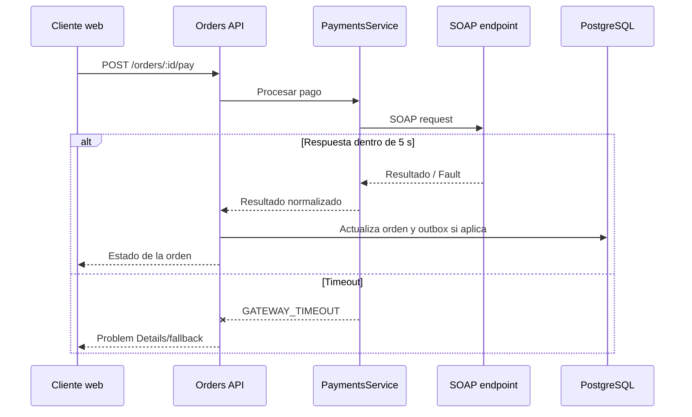
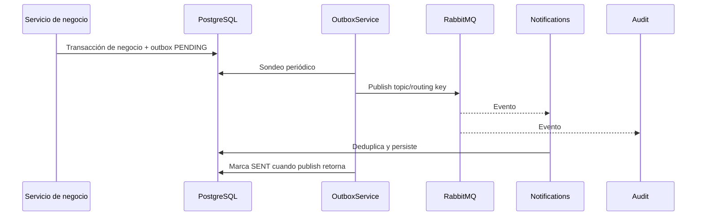

# Documento técnico de EventHub

**Versión:** implementación actual
**Revisión:** 28/11/2026

## 1. Alcance

EventHub es una aplicación web en monorepo pnpm: frontend React/TypeScript, API NestJS, PostgreSQL y RabbitMQ. El backend se organiza como monolito modular; los módulos no son servicios independientes. Este documento describe los flujos comprobables y distingue las integraciones reales de los mocks locales.

## 2. Componentes y persistencia

- **Web:** catálogo y autenticación; los clientes HTTP de checkout/órdenes, entradas y check-in consumen `/api/orders`, `/api/tickets/me` y `/api/check-in/:id/scan`.
- **API:** controllers, servicios de negocio, TypeORM, adaptador SOAP, cliente REST de geocodificación y consumidores RabbitMQ.
- **PostgreSQL:** entidades de negocio y tabla `outbox_messages`. Los cambios compatibles con el outbox guardan el mensaje dentro de la transacción que realiza la operación.
- **RabbitMQ:** exchange `topic`, colas de notificaciones/auditoría y DLQ. Los consumidores procesan eventos de dominio; notificaciones persisten `messageId` para deduplicar.
- **SOAP y REST:** pueden dirigirse a mocks locales en Docker Compose. Las variables `PAYMENTS_WSDL_URL` y `GEOCODING_URL` permiten configurar los endpoints.

La ruta `/api` pertenece al cliente/proxy web; los controllers NestJS exponen rutas como `/orders` y `/tickets/me`.

## 3. Flujo de compra y pago

1. La web crea la orden con `POST /api/orders` y `Idempotency-Key`.
2. La web envía el pago mediante `POST /api/orders/:id/pay`.
3. La API valida pertenencia, estado y, si llega `If-Match`, la versión de la orden.
4. `PaymentsService` invoca la pasarela SOAP con timeout de 5 segundos.
5. Si el pago se aprueba, la API confirma el estado y encola el evento outbox dentro de la transacción correspondiente.
6. Una respuesta técnica fallida, timeout o circuit breaker devuelve un resultado de error/fallback y no presenta la orden como pagada.

El circuit breaker abre después de tres fallos técnicos consecutivos y vuelve a probar tras 30 segundos. El mock SOAP local permite probar contrato, faults y timeout; no equivale a conectar una pasarela bancaria real.

## 4. Geocodificación REST

Al cambiar la ubicación de un evento, `EventsService` realiza una solicitud GET al servicio de geocodificación. El timeout es de 3 segundos. Si no obtiene coordenadas por error, timeout o resultado vacío, mantiene la actualización del evento y deja `lat`/`lon` en `null`. En local puede apuntar al mock configurado por `GEOCODING_URL`.

## 5. Outbox y límites de entrega

`OutboxService.enqueue` acepta un `EntityManager` para persistir el mensaje junto con la operación de negocio. El dispatcher consulta hasta 50 mensajes `PENDING` cada 2 segundos por defecto. Ante error de publicación aumenta el contador, conserva el estado y reintenta en ciclos posteriores.

`TopicPublisherService` publica mensajes persistentes al exchange `topic` usando un canal AMQP normal. No configura publisher confirms. Cuando `publish` retorna, el outbox marca el registro `SENT`; esto no significa que RabbitMQ haya confirmado la persistencia del mensaje. La prueba de caída/recovery demuestra el comportamiento de los escenarios ensayados, no una garantía absoluta de entrega sin pérdida.

Los consumidores son independientes del dispatcher. Notifications persiste el identificador de mensaje para ignorar duplicados ya procesados. La topología incluye DLQ y pruebas de enrutamiento/reproceso.

## 6. Asistente determinístico

`AiAdvisorService` no realiza inferencia ni llama a un proveedor LLM. El servicio:

- busca patrones de inyección conocidos en `prompt` y `categoryPreference`;
- rechaza un conjunto acotado de consultas fuera de dominio;
- enmascara emails y números que coinciden con el patrón de tarjeta de 16 dígitos;
- genera texto controlado y una respuesta fallback cuando `simulateTimeout` está activo.

Las expresiones regulares no cubren todas las reformulaciones ni toda clase de información personal. Las pruebas verifican este simulador, no un modelo externo.

## 7. Seguridad y consistencia

- Los endpoints protegidos usan JWT y guards de roles.
- DTOs con whitelist y rechazo de propiedades no permitidas se usan en las rutas de escritura donde están configurados.
- Idempotency keys, ETags y transacciones cubren las operaciones implementadas; un ETag desactualizado devuelve `412` y conflictos de estado se expresan como `409`.
- La prueba de solicitudes HOLD concurrentes acredita el comportamiento de la instancia y escenario ensayados; no prueba por sí sola el comportamiento coordinado de varias instancias.
- En el procesamiento SOAP se limita el tiempo de espera y se rechazan entradas XML inseguras según las pruebas del módulo.

## 8. Diagramas de secuencia

### REST: actualización de ubicación

```mermaid
sequenceDiagram
    participant C as Cliente web
    participant E as EventsController/Service
    participant G as Geocode REST
    participant DB as PostgreSQL
    C->>E: PATCH /events/:id (location)
    E->>G: GET /search (timeout 3 s)
    alt Resultado
        G-->>E: lat/lon
    else Timeout o error
        G--xE: Sin coordenadas
    end
    E->>DB: Guarda evento; lat/lon pueden ser null
    E-->>C: Evento actualizado
```

### SOAP: pago



### Mensajería: outbox



## 9. Estado de validación documental

La CI más reciente consultada (run `46105294262`, 28/11/2026) falló en 4 de 6 jobs; el detalle y las métricas locales están en [INFORME_CUMPLIMIENTO_TESTING.md](../testing/INFORME_CUMPLIMIENTO_TESTING.md). No se presenta la medición histórica del 12/11 como resultado actual.
