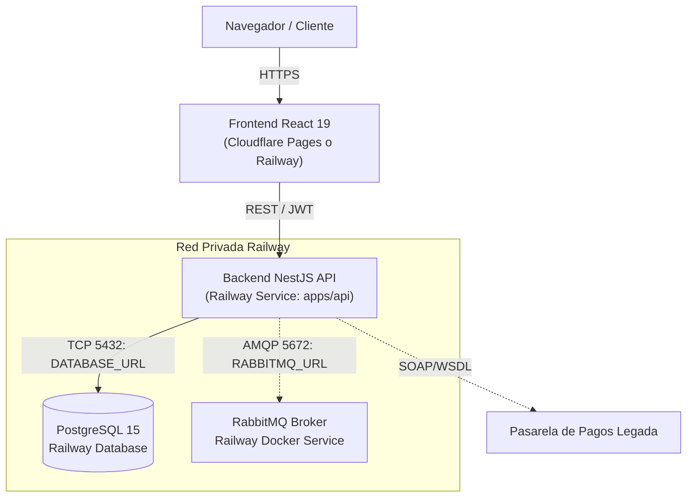

# Guía Completa de Despliegue: Railway (Backend + BD) + Cloudflare Pages / Railway (Frontend)

Esta guía explica paso a paso cómo desplegar **EventHub** en producción utilizando [Railway](https://railway.app), una de las plataformas en la nube más ágiles y robustas para stacks modernos.

---

## 🌟 ¿Por qué Railway para EventHub?

1. **Sin Cold Starts molestos:** A diferencia de planes gratuitos que se duermen a los 15 minutos (demorando ~50 segundos en reaccionar), los servicios en Railway permanecen activos y responden inmediatamente.
2. **Red Privada Interna (`.railway.internal`):** La API de NestJS se conecta a PostgreSQL y RabbitMQ a través de una red privada cifrada de alta velocidad sin exponer los puertos de la base de datos a internet.
3. **Inyección Dinámica de Variables:** Puedes referenciar credenciales directamente entre servicios (ej. `${{Postgres.DATABASE_URL}}`) sin copiar ni exponer contraseñas manualmente.
4. **Soporte Nativo de Monorepo:** Permite configurar el subdirectorio raíz (`apps/api` y `apps/web`) con detección automática de Nixpacks/Node.js.

---

## 🛠️ Arquitectura de Despliegue

---

## 🚀 Paso 1: Crear el Proyecto en Railway

1. Ingresa a [Railway](https://railway.app) e inicia sesión con tu cuenta de GitHub.
2. Haz clic en **New Project** (o **+ Project**).
3. Selecciona **Empty Project**. Esto creará un espacio de trabajo limpio donde añadiremos los servicios.

---

## 🗄️ Paso 2: Agregar la Base de Datos PostgreSQL

1. En el lienzo de tu proyecto de Railway, presiona `Ctrl + K` (o haz clic en **+ Create** / **+ New**).
2. Selecciona **Database** $\rightarrow$ **Add PostgreSQL**.
3. Railway creará el contenedor de PostgreSQL en segundos.
4. *(Opcional)* Haz clic sobre la tarjeta de PostgreSQL y cámbiale el nombre a `Postgres` para simplificar las referencias de variables.
5. Railway genera automáticamente la variable `${{Postgres.DATABASE_URL}}` lista para ser consumida por la API.

---

## 🐇 Paso 3: (Opcional) Agregar el Broker RabbitMQ

Si deseas contar con el broker real de mensajería para notificaciones asíncronas y Dead Letter Queue:

1. Haz clic en **+ Create** $\rightarrow$ **Docker Image**.
2. Escribe: `rabbitmq:3-management-alpine` y presiona Enter.
3. Haz clic en la tarjeta del servicio creado y ve a la pestaña **Variables**:
   - `RABBITMQ_DEFAULT_USER`: `user`
   - `RABBITMQ_DEFAULT_PASS`: `password`
4. En la pestaña **Settings**, renombra el servicio a `RabbitMQ`.
5. En la sección **Networking**, haz clic en **Add Port** y agrega el puerto `5672` (AMQP).

---

## 🔌 Paso 4: Desplegar el Backend API (NestJS)

1. En el mismo proyecto, haz clic en **+ Create** $\rightarrow$ **GitHub Repo**.
2. Selecciona tu repositorio: `EventHub`.
3. Haz clic sobre la tarjeta del nuevo servicio y ve a la pestaña **Settings**:
   - **Service Name:** Cámbialo a `eventhub-api`.
   - **Root Directory:** Escribe `apps/api` (¡fundamental para monorepo!).
   - **Build Command:** `npm install --include=dev && npm run build` (o déjalo vacío para usar el archivo [apps/api/railway.json](file:///C:/Users/jazmin/OneDrive/Documentos/EVENTHUB/EventHub-main/EventHub-main/apps/api/railway.json) incluido).
   - **Start Command:** `npm run start:prod`
   - **Healthcheck Path:** `/events`

4. Ve a la pestaña **Variables** y agrega las siguientes variables de entorno:

| Variable | Valor en Railway | Explicación |
|---|---|---|
| `NODE_ENV` | `production` | Modo producción optimizado. |
| `DATABASE_URL` | `${{Postgres.DATABASE_URL}}` | Referencia automática a tu base PostgreSQL. |
| `DB_SYNCHRONIZE` | `true` | Crea automáticamente las tablas de EventHub al primer inicio. |
| `DB_SSL` | `false` | En la red interna de Railway la conexión no requiere SSL. |
| `JWT_SECRET` | `super-secreto-eventhub-railway-2026` | Clave secreta para firmar y validar tokens JWT. |
| `PAYMENTS_WSDL_URL` | `https://www.dataaccess.com/webservicesserver/NumberConversion.wso?WSDL` | WSDL para el cliente SOAP legado. |
| `FRONTEND_URL` | `https://...` *(se completa tras el paso 5)* | Dominio de tu frontend para permitir peticiones CORS. |
| `RABBITMQ_URL` | `amqp://user:password@${{RabbitMQ.RAILWAY_PRIVATE_DOMAIN}}:5672` | *(Solo si añadiste RabbitMQ en el paso 3)* |

5. Generar URL pública para la API:
   - Ve a **Settings** $\rightarrow$ sección **Networking**.
   - Haz clic en **Generate Domain**.
   - Railway te asignará un dominio público, por ejemplo:
     `https://eventhub-api-production.up.railway.app`
   - Guarda esta URL, la usarás en el frontend.

---

## 🌐 Paso 5: Desplegar el Frontend Web

Tienes dos opciones excelentes: **Cloudflare Pages** (gratuito e instantáneo con CDN global) o **Railway** (todo en el mismo panel).

### Opción 5.A: En Cloudflare Pages (Recomendado)

1. Ingresa a [Cloudflare Dashboard](https://dash.cloudflare.com/) $\rightarrow$ **Workers & Pages** $\rightarrow$ **Create Application** $\rightarrow$ pestaña **Pages** $\rightarrow$ **Connect to Git**.
2. Selecciona el repositorio `EventHub`.
3. Configura los parámetros:
   - **Project Name:** `eventhub-web`
   - **Production Branch:** `main`
   - **Root Directory:** `apps/web`
   - **Build Command:** `pnpm run build` (o `npm run build`)
   - **Build Output Directory:** `dist`
4. En **Environment Variables (Production)**, agrega:
   - `VITE_API_URL`: Pega la URL pública de tu API generada en Railway **sin barra final**, por ejemplo:
     `https://eventhub-api-production.up.railway.app`
5. Haz clic en **Save and Deploy**.
6. Gracias al archivo [apps/web/public/_redirects](file:///C:/Users/jazmin/OneDrive/Documentos/EVENTHUB/EventHub-main/EventHub-main/apps/web/public/_redirects) (`/* /index.html 200`), las rutas internas de React funcionan perfectamente al recargar en Cloudflare.

---

### Opción 5.B: Directamente en Railway

Si prefieres tener backend, frontend y base de datos en un solo panel de Railway:

1. En el mismo proyecto de Railway, haz clic en **+ Create** $\rightarrow$ **GitHub Repo** $\rightarrow$ selecciona `EventHub`.
2. Renombra el servicio a `eventhub-web`.
3. En la pestaña **Settings**:
   - **Root Directory:** `apps/web`
   - **Build Command:** `npm install && npm run build` (utiliza el archivo [apps/web/railway.json](file:///C:/Users/jazmin/OneDrive/Documentos/EVENTHUB/EventHub-main/EventHub-main/apps/web/railway.json)).
   - **Start Command:** `npx -y serve -s dist -l $PORT`
4. En la pestaña **Variables**:
   - `VITE_API_URL`: Pega la URL pública de la API (ej. `https://eventhub-api-production.up.railway.app`).
5. En **Settings** $\rightarrow$ **Networking**, haz clic en **Generate Domain**.

---

## 🔒 Paso 6: Vincular CORS en la API

Una vez que tengas el dominio público de tu Frontend (sea de Cloudflare Pages o de Railway):

1. Vuelve al servicio `eventhub-api` en Railway.
2. En la pestaña **Variables**, añade o actualiza:
   - `FRONTEND_URL`: URL completa de tu frontend (ej. `https://eventhub-web.pages.dev` o `https://eventhub-web-production.up.railway.app`).
3. Railway redesplegará la API en pocos segundos aplicando la nueva regla CORS.

> [!TIP]
> La API de EventHub incluye soporte nativo en su configuración de CORS para todos los dominios que terminen en `.pages.dev`, `.railway.app` y `.up.railway.app`, por lo que las peticiones desde estos entornos están autorizadas por defecto.

---

## ✅ Paso 7: Verificación de Funcionamiento

1. **Healthcheck del Backend:**
   Abre en tu navegador:
   `https://tu-api.up.railway.app/events`
   Deberías recibir un JSON con la lista de eventos del seed precargados.

2. **Acceso al Frontend:**
   Abre la URL pública de tu frontend.
   - Verás el catálogo de eventos interactivo cargado en tiempo real desde la API.
   - Ve a **Iniciar sesión** $\rightarrow$ pestaña **Demostración**.
   - Ingresa con cualquiera de los perfiles:
     - Asistente: `maria@eventhub.com.ar` / `password`
     - Organizador: `eventos@eventhub.com.ar` / `password`
     - Staff: `staff@eventhub.com.ar` / `password`
     - Admin: `admin@eventhub.com.ar` / `password`
   - Prueba crear un evento como Organizador o comprar una entrada como Asistente: la orden se creará en PostgreSQL, tomará un HOLD de inventario y emitirá el ticket digital.

---

## 🔧 Solución de Problemas Frecuentes

- **Error de conexión a PostgreSQL:**
  Verifica que `DATABASE_URL` esté configurado con `${{Postgres.DATABASE_URL}}`. Si usas la red interna de Railway, asegúrate de que `DB_SSL` esté en `false`.
- **CORS bloqueado en la consola:**
  Verifica que `FRONTEND_URL` no tenga barra al final (`/`). Ejemplo correcto: `https://mi-web.pages.dev`.
- **El frontend muestra datos vacíos:**
  Abre la consola de desarrollador (`F12` $\rightarrow$ pestaña Red / Network) y confirma que las peticiones hacia `/events` o `/auth/login` estén apuntando a la URL correcta de Railway y devuelvan código `200`.
- **Cold start o reinicios:**
  En Railway los despliegues tardan habitualmente entre 30 y 60 segundos gracias a la caché de Nixpacks.
